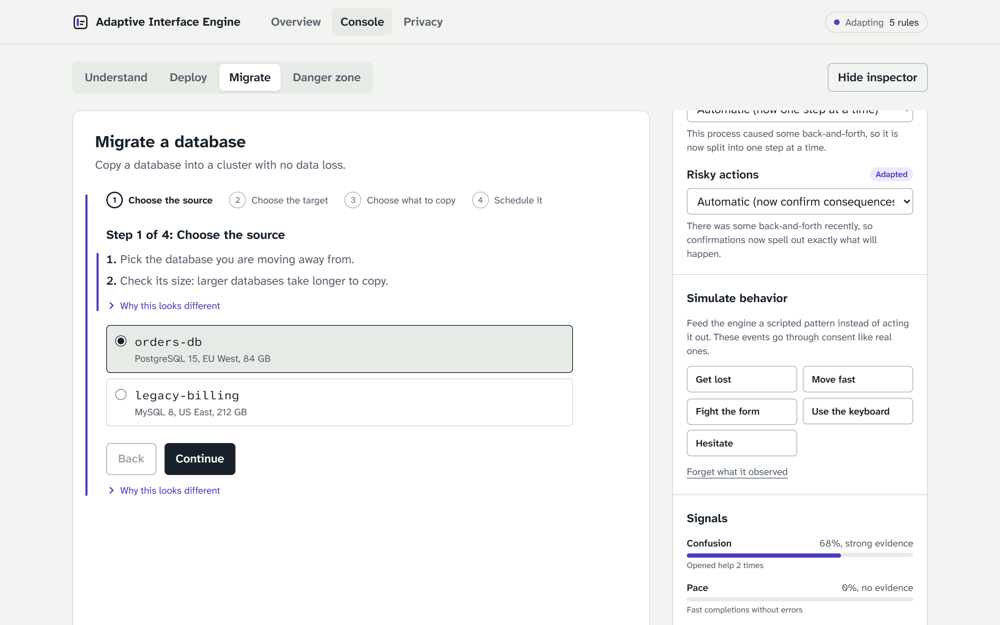
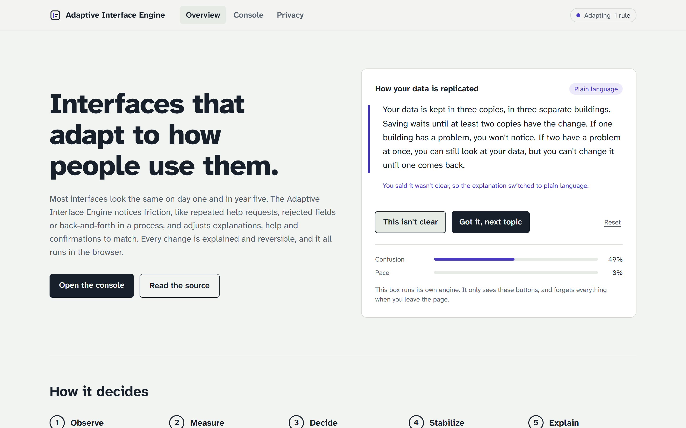
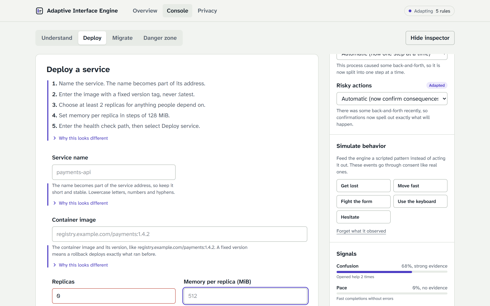
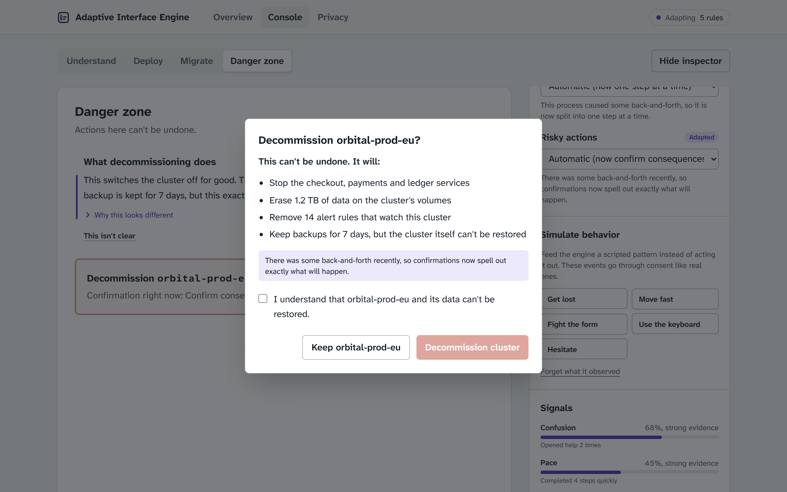
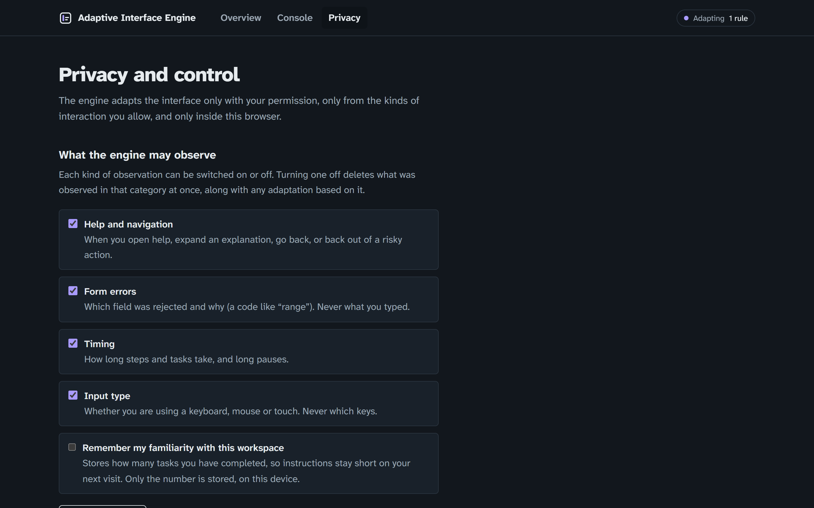

# Adaptive Interface Engine

[](https://github.com/AleReyes77/adaptive-interface-engine/actions/workflows/ci.yml)


**An interface that adapts to how a person is using it, not just to the size of their screen.**

Most interfaces look exactly the same to someone on their first day and to someone in their fifth
year. That creates friction, confusion and mistakes. This engine watches for friction in the
interaction itself (repeated help requests, rejected form fields, back-and-forth in a process,
autopilot clicking near an irreversible action) and adjusts the interface in response:

| When this happens                                             | The interface                                                       |
| ------------------------------------------------------------- | ------------------------------------------------------------------- |
| Someone asks for help or goes back repeatedly                 | Switches explanations to plain language                             |
| Someone completes steps quickly and without errors            | Condenses explanations and hides routine instructions               |
| A form keeps rejecting values                                 | Shows guidance next to every field                                  |
| Someone mostly navigates with the keyboard                    | Surfaces shortcuts and stronger focus outlines                      |
| A multi-step process causes back-and-forth                    | Splits it into one step at a time                                   |
| Someone moves fast, or hesitates, near an irreversible action | Asks them to type the resource name, or to confirm the consequences |

Every change is marked, explains itself in one sentence, and can be undone in one click. It all
runs in the browser, only with consent, and it never infers anything about who the person is.



## Why I built it

I wanted a reference project for a kind of frontend work I think matters more every year:
interfaces that help people understand complex systems, make decisions and avoid risky mistakes.
The interesting part is not a page, it is a system: an engine with a closed vocabulary, a clear
decision trace, hysteresis so nothing flickers, and privacy built into the data model rather
than bolted on.

## Features

- **Framework-agnostic engine** in pure TypeScript: events, decaying signals, declarative rules,
  per-dimension conflict resolution and a stabilizer. No React, no DOM.
- **Explainable by construction.** Every decision records the rule that won, the sentence the
  person reads, and the rules it outranked.
- **No flicker.** Help arrives at once; it is withdrawn only after the pattern has held for 20
  seconds. A stricter confirmation is never delayed, and an open dialog never changes.
- **Privacy by design.** Consent per category, all off by default; events are sanitized so typed
  values can't enter them; in memory only, for 20 minutes; export and delete in one click.
- **No personal inference.** Rules can only read interaction signals and write interface
  dimensions, and a guard rejects rule text that mentions diagnoses, disabilities, age or other
  personal traits (English and Spanish).
- **React bindings** with SSR-safe hydration and headless behaviors for fields, multi-step flows,
  irreversible confirmations and task timing.
- **A demo console** with four scenarios, an engine inspector (live signals, rules, overrides,
  event log, behavior simulation) and a privacy center.
- **Optional AI** rewording of authored explanations with Claude, restricted to a topic id and a
  level, so no personal data can reach the model.

## Quick start

```bash
git clone https://github.com/AleReyes77/adaptive-interface-engine.git
cd adaptive-interface-engine
npm install
npm run dev
```

Open http://localhost:3000, allow adaptation, then try the console. The inspector's
**Simulate behavior** buttons replay realistic patterns if you'd rather not act them out.

To enable the optional AI rewording, copy `apps/web/.env.example` to `apps/web/.env.local` and set
`ANTHROPIC_API_KEY`.

## Using the engine

```ts
import { createAdaptiveEngine } from "@aie/engine";

const engine = createAdaptiveEngine({ consent: { interaction: true, forms: true } });

engine.track({ type: "field.error", formId: "deploy", fieldId: "replicas", code: "range" });
engine.track({ type: "field.error", formId: "deploy", fieldId: "memory", code: "step" });
engine.track({ type: "field.error", formId: "deploy", fieldId: "image", code: "latest" });

const { profile, decisions } = engine.getSnapshot();
profile.contextualHelp; // "proactive"
decisions.contextualHelp.reason; // "A few fields were rejected, so help is now shown next to each field..."
```

In React:

```tsx
import { AdaptiveProvider, useDimension, useFieldAssist } from "@aie/react";

function ReplicasField({ error }: { error: string | null }) {
  const assist = useFieldAssist({ formId: "deploy", fieldId: "replicas" });
  return (
    <>
      <input aria-invalid={error !== null} />
      {assist.showHelp(error !== null) && (
        <p>Use at least 2 replicas for anything people depend on.</p>
      )}
    </>
  );
}

export default function App() {
  return (
    <AdaptiveProvider>
      <ReplicasField error={null} />
    </AdaptiveProvider>
  );
}
```

## Architecture

```
packages/
  engine/   @aie/engine   events → signals → rules → resolver → stabilizer → snapshot
  react/    @aie/react    provider, hooks, headless behaviors, persistence, modality detection
apps/
  web/      @aie/web      Next.js demo: landing, console, inspector, privacy center, AI route
docs/       architecture, privacy model, rule authoring guide, ADRs, design
```

Read more in [docs/architecture.md](docs/architecture.md), the
[privacy model](docs/privacy.md), the [rule authoring guide](docs/rules.md) and the
[architecture decision records](docs/adr).

## Quality

| Check                               | Command                             |
| ----------------------------------- | ----------------------------------- |
| Lint and format (Biome)             | `npm run lint`                      |
| Strict TypeScript                   | `npm run typecheck`                 |
| Unit and integration tests (Vitest) | `npm test`                          |
| Coverage thresholds                 | `npm run test:coverage`             |
| End-to-end tests (Playwright)       | `npm run build && npm run test:e2e` |

The engine and React bindings were written test-first. CI runs every check above on each push.

## Screenshots

|                                                                                        |                                                                                  |
| -------------------------------------------------------------------------------------- | -------------------------------------------------------------------------------- |
|  |  |
|    |                      |

## Roadmap

- Publish `@aie/engine` and `@aie/react` to npm with a build step.
- A rule playground for writing and testing rule sets in the browser.
- Per-dimension stabilizer timings.
- An evaluation set for the optional AI rewording's factual faithfulness.

## License

[MIT](LICENSE) © 2026 Jose Alejandro Varela Reyes
