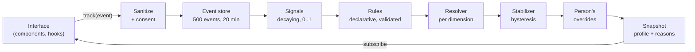

# Architecture

This document explains how the Adaptive Interface Engine turns interaction into interface changes,
and where each responsibility lives in the code.

## The pipeline

Every arrow is a pure function except the store and the stabilizer, which hold a little state.
The engine recomputes on every accepted event and on a periodic `tick()` (signal decay and pending
relaxations), and notifies subscribers only when something meaningful changed.

## Packages

| Package       | Responsibility                                                       | Depends on    |
| ------------- | -------------------------------------------------------------------- | ------------- |
| `@aie/engine` | Events, signals, rules, resolution, stabilization, the engine object | `zod`         |
| `@aie/react`  | Provider, hooks, headless behaviors, modality detection, persistence | engine, React |
| `@aie/web`    | Next.js demo: landing, console, inspector, privacy center, AI route  | both          |

The engine never imports React, Next.js or browser globals. This is enforced by package
dependencies, a Biome `noRestrictedImports` rule and `packages/engine/test/architecture.test.ts`.

## Engine modules

| Module       | File                        | What it does                                                       |
| ------------ | --------------------------- | ------------------------------------------------------------------ |
| Taxonomy     | `src/events/taxonomy.ts`    | 14 event types, consent category per type, zod sanitizer           |
| Store        | `src/events/store.ts`       | Bounded ring buffer with retention window and purge                |
| Consent      | `src/privacy/consent.ts`    | Four categories plus `remember`, all off by default                |
| Signals      | `src/signals/compute.ts`    | Seven signals with value, confidence and plain-language reasons    |
| Decay        | `src/signals/decay.ts`      | Half-life weighting and saturation onto `[0, 1)`                   |
| Dimensions   | `src/profile/dimensions.ts` | The six adaptable dimensions, ordered by support                   |
| Rules        | `src/rules/*`               | Types, schema, guard, evaluation, descriptions, defaults           |
| Resolver     | `src/profile/resolve.ts`    | Picks a winner per dimension and records who lost                  |
| Stabilizer   | `src/profile/stabilizer.ts` | Escalate fast, relax slow, never delay a stricter confirmation     |
| Engine       | `src/engine.ts`             | Orchestration, snapshot, subscriptions, consent, overrides, export |
| Explanations | `src/explain/provider.ts`   | Static provider and fallback composition                           |

### Signals

Each event contributes evidence weighted by `0.5 ^ (age / halfLife)` (half-life 5 minutes), and the
sum is mapped onto `[0, 1)` with `1 - e^(-x / scale)`. A signal also reports `confidence` (how much
evidence backs it) so rules can refuse to act on a single click.

| Signal             | Evidence                                                                                                           |
| ------------------ | ------------------------------------------------------------------------------------------------------------------ |
| `confusion`        | help opened (1), explanation expanded (0.6), going back (0.8), long pause (1), backing out of a risky action (0.4) |
| `fluency`          | fast step and task completions, discounted by the share of errors                                                  |
| `formFriction`     | field errors, offset by corrections (−0.3 each)                                                                    |
| `keyboardReliance` | decayed share of keyboard among input-modality events                                                              |
| `flowStruggle`     | going back and slow steps                                                                                          |
| `riskCaution`      | backing out of (1) and starting (0.3) irreversible actions                                                         |
| `experience`       | lifetime completed tasks (only with `remember`)                                                                    |

### Resolution

All matching rules are ranked by priority, then by specificity (number of comparisons), then by id
so the result is deterministic. Each dimension is decided independently. The decision records the
winning rule, its user-facing sentence and the rules it outranked.

### Snapshot

`getSnapshot()` returns an immutable object that keeps the same reference until something changes,
which makes it safe for React's `useSyncExternalStore`. A cheap fingerprint (profile, decisions,
rounded signals, event count, consent, overrides, pending changes) decides whether a recompute is
worth announcing.

## React integration

- `AdaptiveProvider` creates one engine, restores stored choices, reports input modality, runs the
  tick interval and saves choices synchronously inside the engine's change notification.
- Server rendering and hydration always use `SERVER_SNAPSHOT` (the default profile), so the HTML is
  identical for everyone and hydration never mismatches. Stored choices apply right after.
- Headless behaviors encapsulate the interaction logic so the presentation layer stays dumb:
  `useFieldAssist`, `useIrreversibleConfirmation`, `useAdaptiveFlow`, `useTaskTimer`.

## Presentation (apps/web)

- `<Adapted dimension>` marks any adapted region with a violet notch and a "Why this looks
  different" disclosure that offers the standard version in one click.
- The console's four scenarios each exercise different dimensions; the inspector shows the live
  snapshot, lets a person pin any dimension and can feed scripted behavior to the engine.
- `/api/explain` is the only server code. See [ADR-0005](adr/0005-optional-ai-limited-to-authored-content.md).

## Testing strategy

| Layer      | Tool                             | What is covered                                                          |
| ---------- | -------------------------------- | ------------------------------------------------------------------------ |
| Engine     | Vitest                           | Every module, with an injected clock; architecture boundary              |
| React      | Vitest + Testing Library + jsdom | SSR snapshot, corrupt storage, modality, behaviors, persistence timing   |
| Web logic  | Vitest                           | Form validation, simulations against the real engine, API route contract |
| End to end | Playwright                       | Consent, adaptation, strict confirmation, keyboard, form help, deletion  |

## Decisions

- [ADR-0001](adr/0001-declarative-rules-over-interaction-signals.md) Declarative rules over interaction signals
- [ADR-0002](adr/0002-local-only-consent-gated-observation.md) Local-only, consent-gated observation
- [ADR-0003](adr/0003-asymmetric-hysteresis.md) Asymmetric hysteresis
- [ADR-0004](adr/0004-framework-agnostic-engine-in-a-monorepo.md) Framework-agnostic engine in a monorepo
- [ADR-0005](adr/0005-optional-ai-limited-to-authored-content.md) Optional AI limited to authored content
